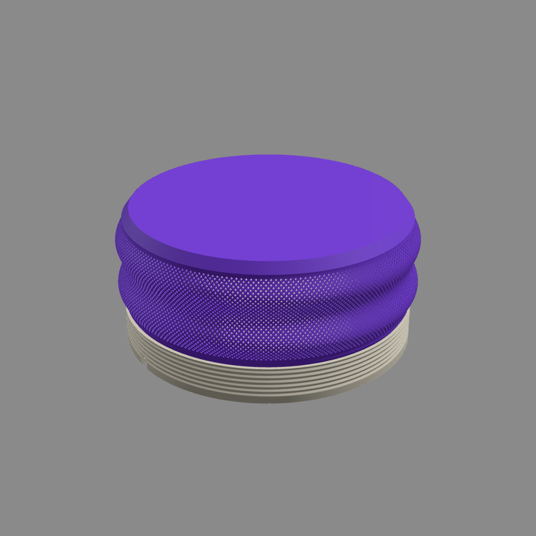
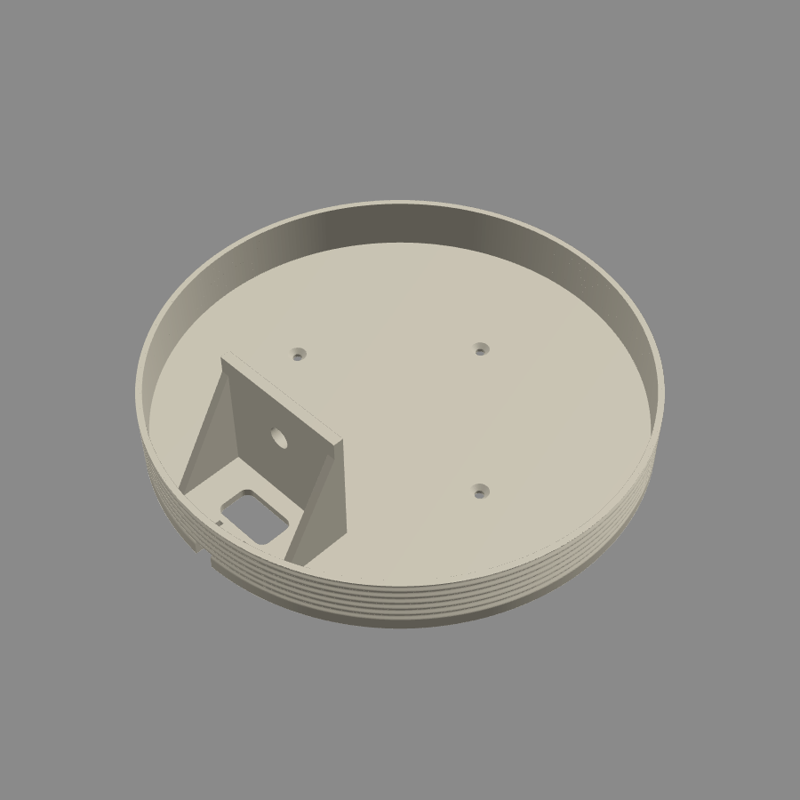
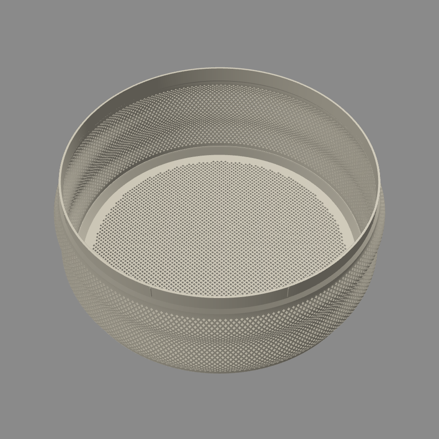
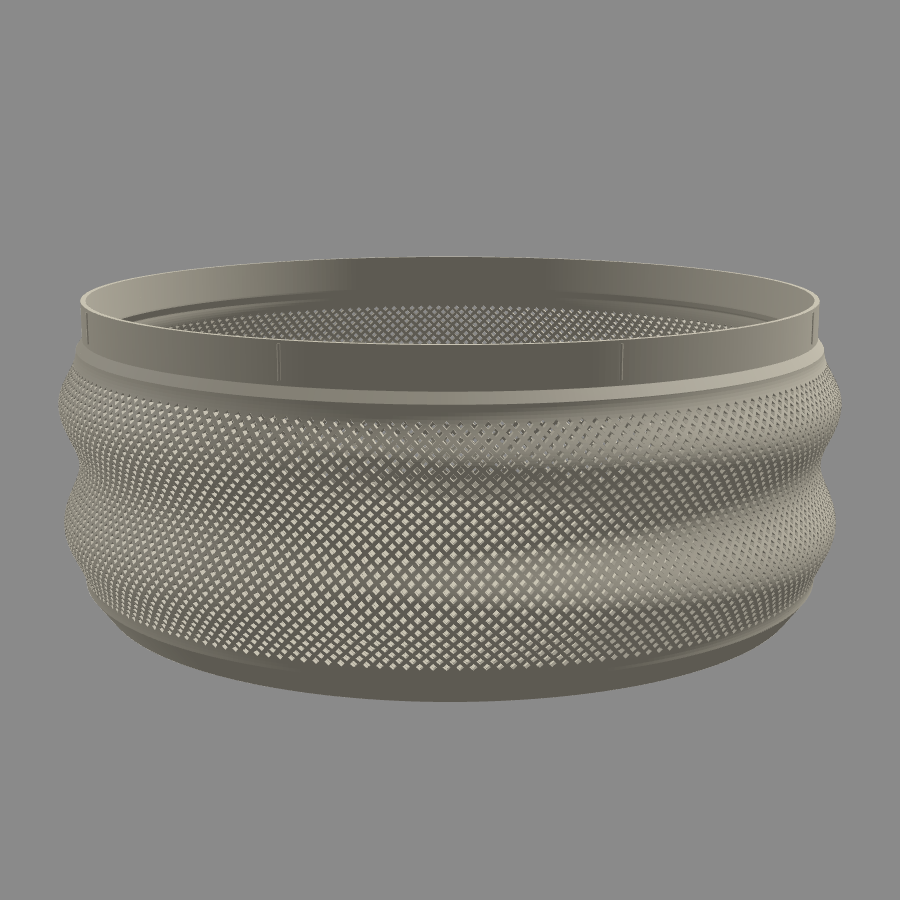

# Vägglampa i "MALLA"-stil – för Bambu Lab A1

Egen, parametrisk tolkning av en rund vägglampa med nätskärm och räfflad väggbas
(ca Ø 248 mm, ca 115 mm djup). Modellen är byggd från grunden utifrån
referensbilder – det är inte originalfilerna från Cults3D.



| Bas (väggdel) | Skärm, inifrån | Skärm i utskriftsläge |
|---|---|---|
|  |  |  |

## Filer

| Fil | Del | Mått (mm) |
|---|---|---|
| `3mf/bas.3mf` | Väggbas med sockelhylla, kabelurtag, buntbandsspår och 3 försänkta skruvhål | 238 × 238 × 66 |
| `3mf/skarm_nat_front.3mf` | Skärm med nätmönster runt om **och** på fronten | 248 × 248 × 97 |
| `3mf/skarm_hel_front.3mf` | Skärm med nät runt om och hel front (bländar mindre) | 248 × 248 × 97 |
| `3mf/skarm_snabb.3mf` | Glesare nät (≈ 4 000 hål i stället för ≈ 13 000) och hel front – betydligt kortare utskriftstid | 248 × 248 × 97 |

Skriv ut basen + **en** av skärmarna. Alla delar ligger redan i rätt
utskriftsläge (basen med baksidan mot plattan, skärmen med fronten mot plattan)
och skrivs ut **utan support**. Nätets hål är rutformade med 45°-kanter så att
de bygger sig själva.

## Utskriftsinställningar (Bambu Studio, A1, 0,4 mm munstycke)

| Inställning | Bas | Skärm |
|---|---|---|
| Material | PLA / PETG | PLA eller PETG (ljus/transparent färg ger snyggast ljus) |
| Lagerhöjd | 0,20 mm | 0,16–0,20 mm |
| Väggar (wall loops) | 3 | 4 (väggen är 1,6 mm – då blir den helt solid) |
| Fyllnad | 15 % | – (solid) |
| Support | Av | Av |
| Brim | Av | Av (få mm marginal på 256-plattan) |
| Sömposition | Valfri | *Aligned* eller *Back* |

Tips:
- Nätskärmen med nätfront har ca 13 000 små hål (≈ 15 h vid 0,20 mm) – välj `skarm_snabb` om det går för långsamt. Sänk gärna
  *travel*-hastigheten något om den börjar dra trådar, och slå på
  *Avoid crossing walls*.
- Torka filamentet först (särskilt PETG), annars blir det mycket strängar i
  nätet.
- Skärmen är 248 mm bred och A1-plattan 256 mm – placera den mitt på plattan.

## Montering

1. Skruva fast en E27-sockel med **M10-nippel** i hyllan (hål Ø 10,5 mm).
   Sockeln pekar uppåt när lampan hänger på väggen.
2. Dra kabeln ned bakom hyllan och ut genom urtaget i basens nederkant
   (eller genom det rektangulära hålet i bakplattan om du har kabel/dosa i väggen).
   Lås kabeln med ett buntband genom de två spåren som dragavlastning.
3. Skruva upp basen på väggen med 3 st 4 mm skruvar (försänkta).
4. Tryck in skärmens krage i basens ring. Åtta små klämlister ger
   friktionspassning – skärmen kan dras ut för att byta lampa.
   Sitter den för löst/hårt: ändra `FIT_CLEARANCE` eller `CRUSH_RIB_PROUD`.

> **Säkerhet:** Använd **endast LED-lampa** (max ca 8 W, t.ex. E27 A60 LED).
> Glödlampor och halogen blir för varma för plast. Fast elinstallation ska
> utföras av behörig elinstallatör – en färdig sladd med stickpropp och
> strömbrytare kan du koppla själv.

## Anpassa modellen

Alla mått finns som parametrar överst i `generate.py`
(skärmprofil, nätdelning, hålstorlek, passning, hyllans läge, skruvhål …).

```bash
pip install manifold3d numpy
python3 generate.py          # skapar 3MF-filerna i 3mf/
python3 generate.py --stl    # skapar dessutom STL-filer i stl/
```

Några bra parametrar att leka med:

- `MESH_PITCH` / `MESH_HOLE_K` – tätare eller glesare nät
  (strängbredden blir `MESH_PITCH·(1−MESH_HOLE_K)/√2`, håll den ≥ 0,9 mm).
- `SHADE_PROFILE` – formen på skärmens två "bubblor".
- `SOCKET_HOLE_D` – byt t.ex. till 40,5 om din sockel har en gängad ring i
  stället för M10-nippel.
